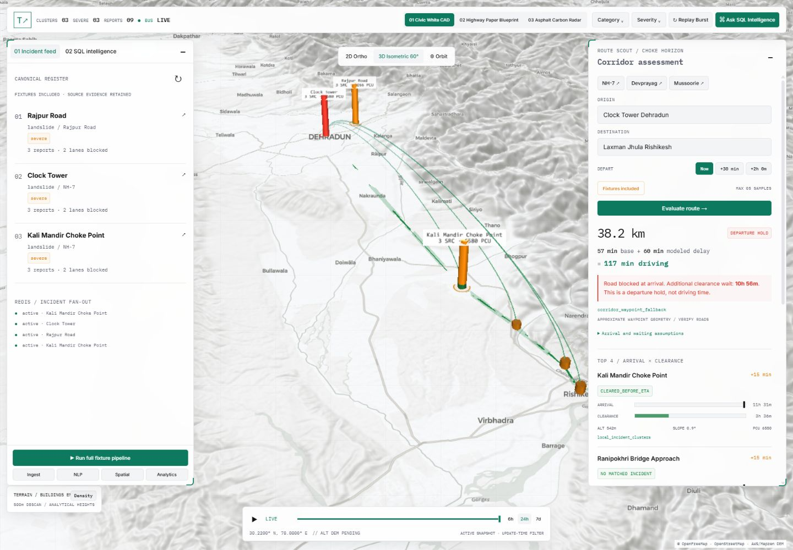

# TrafficSense

**LLM-based urban incident intelligence for Indian roads.** TrafficSense turns
news, civic advisories and public reports into mapped incidents, estimated
clearance times and route advisories. B.Tech project, Graphic Era Deemed to be
University, Dehradun (2026-27; MP2026CSE126).



## Features

- FastAPI workers and Redis Streams with durable outboxes, bounded retries,
  dead-letter handling and startup catch-up.
- News/social/civic/hazard/traffic adapters, source failure isolation, and
  persistent URL/content deduplication.
- SetFit relevance/temporal classification and schema-validated extraction, plus
  a reference mode that needs no model downloads or API keys.
- Cache-first landmark geocoding, optional Geoapify/Nominatim fallbacks, and
  PostGIS DBSCAN clustering with 500-meter and 60-minute limits.
- Three-level clearance estimates from corridor history, spatial neighbors and
  physical models using Passenger Car Units (PCU), with explicit bounds.
- ETA-aware route checks, optional TomTom/HERE flow and OpenRouteService detours.
- React/TypeScript 3D console using MapLibre GL JS, deck.gl and SSE; natural-language
  queries use four parameterized, read-only SQL templates.

## Quick start on Windows

Install **Git**, **Python 3.11** (including the Windows Python launcher),
**Node.js 24 LTS** (minimum 22.12), and **Docker Desktop with Linux containers**.
Start Docker Desktop first. Internet is needed for dependency/container downloads
and map tiles, fonts and terrain. Use a current browser with WebGL2 and hardware
acceleration enabled. A GPU for machine learning and provider keys are not required.

Clone the repository, then run:

```powershell
git clone https://github.com/nullnayan/TrafficSense.git
cd TrafficSense
powershell -NoProfile -ExecutionPolicy Bypass -File .\start.ps1
```

The launcher creates `.venv` and `.env` if missing, installs dependencies, starts PostGIS/Redis,
applies migrations and opens **http://127.0.0.1:5173**. Existing `.env` files are
preserved. The execution-policy flag affects only this PowerShell process.

Open the console drawer and click **Run full fixture pipeline** to load sample
incidents near Rajpur Road, Dehradun. Alternatively, run `.\dev.ps1 demo` from a
second terminal. Include fixture incidents when testing routes or the assistant.
API documentation: **http://127.0.0.1:8000/docs**.

Keep the launcher window open. **Ctrl+C** stops its API/UI processes. Run
`.\dev.ps1 down` separately to stop database containers without deleting data.
On subsequent visits, use the same `start.ps1` command.

## macOS / Linux, or manual startup

Install Python 3.11, Node.js 24 and Docker Engine/Desktop with Compose v2+.
From the cloned repository:

```bash
python3.11 -m venv .venv
.venv/bin/python -m pip install -r requirements-dev.txt
cp -n .env.example .env
docker compose up -d --wait
make migrate
npm --prefix frontend ci
```

Start the backend and frontend in two terminals:

```bash
# Terminal 1, repository root
.venv/bin/python -m uvicorn backend.main:app --host 127.0.0.1 --port 8000
```

```bash
# Terminal 2, repository root
npm --prefix frontend run dev
```

Open **http://127.0.0.1:5173**, then click **Run full fixture pipeline**, or run
`.venv/bin/python -m backend.streaming.demo_pipeline` from a third terminal.
Windows manual equivalents: `.\dev.ps1 setup`, `up`, `migrate`, then `api` and
`ui` in separate windows.

## Demo versus live sources

The template selects `INFERENCE_MODE=calibrated_teacher`, fixture ingestion and
disabled automatic ingestion, public scrapers and external routing/traffic.
Fresh clones get a keyless demo; map resources still need internet. Fixture
records are synthetic.

For live sources, edit your local `.env`: select `INGESTION_SOURCE_MODE=live`,
set `INGESTION_ENABLED=true` for automatic polling, and add your own provider
keys. Adapters activate independently. Enable public scrapers, live Scout traffic,
Nominatim or OSRM explicitly if needed. Providers have their own access rules,
quotas and pricing. Provider credentials belong in the backend, never the frontend.

Weights/checkpoints are excluded from Git. For local SetFit training, install
`training/requirements-setfit.txt` into `.venv` and follow [the training guide](training/README.md).
Training downloads a base model. The QLoRA notebook targets a Colab T4; adapters
still need runtime integration and independent evaluation. The reference demo
needs neither model.

## Verification

```powershell
# Windows, repository root
.\.venv\Scripts\python.exe scripts/check_publication.py
.\dev.ps1 lint
.\dev.ps1 test
npm --prefix frontend test
npm --prefix frontend run build
```

Use `.venv/bin/python` on macOS/Linux. Database tests skip unless
`TRAFFICSENSE_INTEGRATION=1` is set. For the full suite, start PostGIS/Redis and
apply migrations first, then run:

```powershell
$env:TRAFFICSENSE_INTEGRATION='1'
$env:INFERENCE_MODE='calibrated_teacher'
$env:LLM_API_KEY=''
.\dev.ps1 test
```

GitHub Actions runs the publication guard, Ruff, the integration-enabled backend
suite with PostGIS/Redis, and frontend tests/build without provider secrets.

## Troubleshooting

| Problem | Fix |
| --- | --- |
| Docker daemon unavailable | Open Docker Desktop, choose Linux containers, and wait for readiness. |
| Python 3.11 missing | Install Python 3.11 with the Windows launcher; check `py -3.11 --version`. |
| Port 8000 or 5173 occupied | Stop the existing API/UI before using the launcher. |
| PostgreSQL port 5432 occupied | Use the same unused port in `POSTGRES_PORT` and `DATABASE_URL` in `.env`. |
| Redis port 6379 occupied | Stop your other local Redis before starting this stack. |
| Empty map | Run the fixture pipeline and include fixtures; public map resources need internet. |
| Repeated demo adds nothing | Replay is idempotent and does not renew expired fixture timestamps. Data is preserved. |
| Launcher failure | Inspect the ignored files in `logs/` and fix the reported dependency. |
| API calls fail after deployment | Configure an `/api` reverse proxy; Vite's proxy is for development. |

## Layout and evidence

`backend/`: ingestion, NLP, spatial, analytics, routing, assistant and SSE.
`frontend/`: 3D console. `sql/`: schema/seeds/migrations. `tests/`: backend checks.
`training/`: authored data and training scripts. `benchmarks/`: recorded results
and screenshots.

SetFit relevance F1 **0.9756** and temporal macro F1 **0.8979** were recorded on
**24 authored synthetic reports**, separate from **80 training reports**. These
scores and recorded clearance/latency results are development evidence, not field
validation or proof of national-scale performance. Live-provider reliability,
clearance calibration and national-scale resource use still need evaluation.
The timeline filters the current snapshot rather than reconstructing history;
the production build currently warns about a large map bundle.

See the [frontend guide](frontend/README.md), [training guide](training/README.md),
[data notes](data/README.md), and [credential guidance](SECURITY.md).
